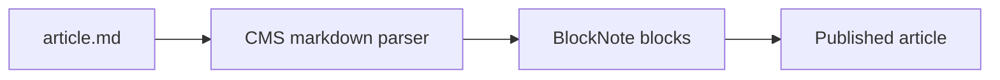

# Markdown rendering fixture

Neutral sample for [Block Style CMS](https://github.com/Byte-Biscuit/block-style-cms) import checks. Covers common block and inline syntax plus six image `src` forms.

## Headings and inline text

This paragraph mixes **bold**, *italic*, ***bold italic***, ~~strikethrough~~, and `inline code`. A [link to the CMS repo](https://github.com/Byte-Biscuit/block-style-cms) should survive conversion.

### Third-level heading

Plain paragraph after a subheading. Use `publish_from_markdown` with `assets_dir` pointing at `samples/assets`.

---

## Unordered list

- First item with **emphasis**
- Second item with `code`
  - Nested bullet
  - Another nested bullet
- Third item

## Ordered list

1. Step one: collect relative images
2. Step two: upload via `POST /api/m/images`
3. Step three: rewrite paths to `/images/{filename}`

## Blockquote

> Structured content should stay readable after import.
> Block quotes can span multiple lines.

## Fenced code block

```python
from block_style_cms_sdk import BlockStyleCmsClient

client = BlockStyleCmsClient(
    base_url="https://cms.example.com",
    api_key="bsc_...",
)
client.articles.publish_from_markdown(
    title="Fixture",
    slug="markdown-rendering-fixture",
    summary="Sample for CMS markdown conversion",
    language="en-US",
    md_file="./samples/article.md",
    assets_dir="./samples/assets",
)
```

## Mermaid diagram



---

## Image sources (six forms)

Each subsection uses one `src` type for SDK image-path handling.

### 1. HTTPS URL


### 2. CMS uploaded path


### 3. Absolute filesystem path


### 4. Relative path with `./`


### 5. Relative path without `./`


### 6. HTML img tag


